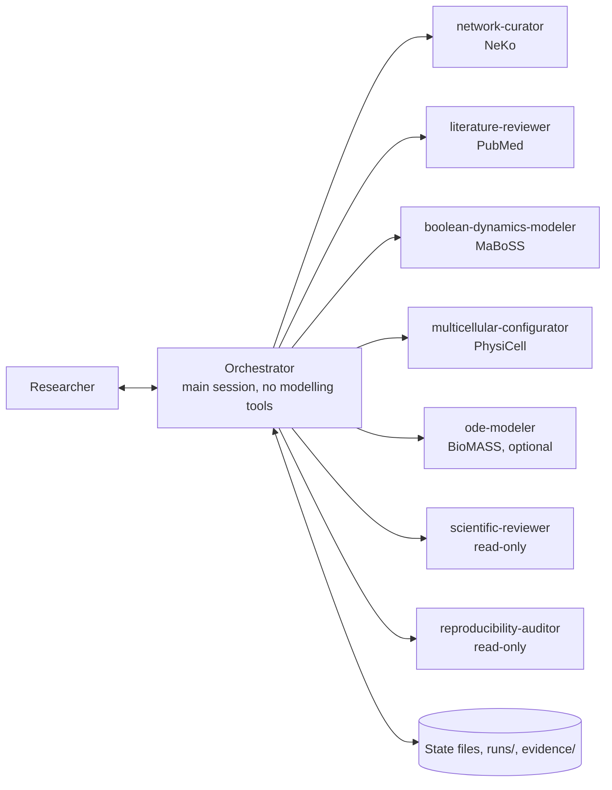
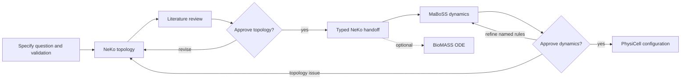

# Agentic system for biological modelling

A Claude Code and local Codex workspace for building **one traceable mechanistic
model per repository**: from a signalling network, through literature-backed
curation and Boolean dynamics, to a multicellular simulation configuration, with an
optional mechanistic ODE branch.

The main session acts as a **scientific orchestrator**. It plans with you, delegates
each modelling operation to a restricted specialist agent, reviews what comes back,
and stops for your approval at every consequential biological choice. Scientific
state lives in version-controlled files, not in chat history.

> **Biologists bringing their own project:** start with the
> [user guide](docs/user-guide.md). It explains what the framework can do for your
> question, how a session goes, which decisions you make and how to read the results.

Release **1.0.1**, tested with `mcp-biomodelling-servers` **2.5.1** (NeKo
`nekomata` 1.10.2, PhysiCell Settings 0.6.3, bundled cmaboss, BioMASS 0.14). See
[`CHANGELOG.md`](CHANGELOG.md) for changes and known limitations.

## What it can help you do

| Stage | What you get | Engine |
|---|---|---|
| Specification | A written question, scope, entities, observables, units, assumptions and validation criteria before any model is fitted | — |
| Signalling network | Network construction from interaction databases (e.g. SIGNOR, OmniPath), connectivity repair with explicit path/consensus policies, history of how the topology grew, authorized manual edges backed by literature | NeKo |
| Literature evidence | Edge-by-edge PubMed review of existence, direction, sign, directness and context, written as immutable reports per NeKo session | PubMed MCP |
| Boolean dynamics | Stochastic Boolean simulation, wild type versus mutations under matched settings, durable run IDs, researcher-named readout nodes and rates, and explicitly gated rule refinement against your validation targets | MaBoSS |
| Mechanistic ODEs (optional) | ODE models from an approved NeKo graph, a Text2Model file or explicit reactions, with claim-level evidence and provisional/final bundles | BioMASS |
| Multicellular configuration | PhysiCell/PhysiBoSS domain, substrates, cell types, Cell Rules, Boolean-to-phenotype mappings, user parameters, initial-cell CSV and portable configuration bundles | PhysiCell Settings |
| Provenance and review | Session registry and lineage, hashed artifact capture, stage gates bound to exact reviewed revisions, independent scientific review and reproducibility audit, Git checkpoints and archives | this repository |

What it does **not** do: it does not run PhysiCell simulations (it produces
configuration for an existing executable), it does not treat successful execution
as biological validation, and it never invents units, parameter values or citations.
ODE work additionally requires the ODE readiness check to pass for the pinned
backend; it passed on 2026-10-26 with 2.5.1 ([ODE workflow](docs/ode-workflow.md#ode-readiness-check)).

## How it works



- **Isolation.** Each modelling specialist starts its own MCP server inline in its
  definition and sees only that server; the orchestrator has no modelling tools.
  Specialists cannot delegate, edit shared state or advance stages.
- **Approvals.** Exploration and read-only inspection are autonomous. Topology
  changes, rule changes, readouts/rates, conclusive handoff exports and stage
  transitions need your explicit approval, recorded in `DECISIONS.md` with your
  words. An approval binds to the exact NeKo state or MaBoSS `model_revision` that
  was reviewed; any later edit supersedes it.
- **Gates.** Before a downstream stage, both independent reviewers must finish and
  `scripts/gate.py` must pass against the durable records. A dispatch hook re-checks
  this before Claude starts the MaBoSS or PhysiCell specialist.
- **Provenance tags.** Every final rule and manual edge is labelled in
  `DECISIONS.md`: `database-default`, `literature-derived`, `manual-literature`,
  `fitted-for-dynamics` or `readout`.
- **Sessions.** NeKo, MaBoSS, PhysiCell and BioMASS each issue their own session ID.
  `CURRENT_STATE.md` keeps an append-only registry linking every session to the
  upstream session it was derived from.

The policy the orchestrator follows is [`CLAUDE.md`](CLAUDE.md) (Claude) and
[`AGENTS.md`](AGENTS.md) (Codex). Design rationale:
[architecture](docs/agentic-biomodelling-architecture.md).

### Agents

| Agent | Role | MCP access |
|---|---|---|
| `network-curator` | Construct, inspect, curate (including authorized manual-literature edges), compare and export NeKo networks | Inline NeKo server only |
| `literature-reviewer` | Review evidence for edges, mechanisms and assumptions; write guarded edge reports | Configured `pubmed` server |
| `boolean-dynamics-modeler` | Import NeKo handoffs, durable MaBoSS runs and mutations, named readouts/rates, bounded rule refinement | Inline MaBoSS server only |
| `multicellular-configurator` | PhysiCell/PhysiBoSS domain, cells, substrates, rules, mappings, inputs and configuration bundles | Inline PhysiCell server only |
| `ode-modeler` | Optional mechanistic ODEs; preserve candidates and run approved scenarios | Inline BioMASS server only |
| `scientific-reviewer` | Independent review of a bounded stage against its specification and evidence | None (Read/Grep/Glob) |
| `reproducibility-auditor` | Independent audit of provenance, lineage and recorded verification | None (Read/Grep/Glob) |

## Requirements

- Linux or WSL, Git, Python 3.11+
- Claude Code (custom agents and skills) and/or a local Codex client 0.153.0+
- One of:
  - [uv](https://docs.astral.sh/uv/) — servers start exactly like the marketplace
    plugins, nothing else to install (recommended); or
  - a Conda/venv environment created or reused by setup
- Network access to the shared PubMed MCP endpoint (`https://pubmed.mcp.claude.com/mcp`)

No MaBoSS executable or system Graphviz is needed; the 2.5.x servers bundle both.
The agents inherit the model running the main session.

## Quick start (Claude Code)

```text
git clone <repository-url> my-model && cd my-model
curl -LsSf https://astral.sh/uv/install.sh | sh          # if uv is not installed
python scripts/setup.py --client claude --environment-mode plugin --with-biomass
python scripts/check_isolation.py
claude
```

Inside Claude Code, run `/agents` to confirm the agents, and `/mcp` to confirm the
`pubmed` server. Modelling servers are not connected to the main session: they are
scoped to their specialists and start only when a specialist runs (the first start may take a minute
while uv downloads the release). `--with-biomass` configures and verifies the
optional ODE specialist; omit it if you only need the Boolean path. Then describe your
question:

```text
I want to model how EGFR inhibition changes apoptosis in this cell type. Help me
complete the specification and tell me which decisions need my approval.
```

Setup options (managed Conda/venv environment, reuse of an existing environment,
`--dry-run`, `--check`, source installs) are in
[automatic setup](docs/automatic-setup.md). For Codex, see [Codex](#codex) below.

### Marketplace plugins

The same servers are published as plugins in the `marcorusc` marketplace
(`neko@marcorusc`, `maboss@marcorusc`, `physicell@marcorusc`, `biomass@marcorusc`).
This project uses their launch command,
`uvx --from mcp-biomodelling-servers==2.5.1 mcp-<server>-server`, **inline in each
specialist only**. Do not enable the plugins in this project: Claude Code connects
an enabled plugin's servers to the main session, which would give the orchestrator
modelling tools. Setup and `scripts/check_isolation.py` fail if they are enabled in
project, local or user settings. Use the plugins directly in projects that do not
need this isolation.

### Manual transport configuration

The tracked agent files already launch the plugin command with a bare `uvx`, so a
checkout with uv on PATH works without setup:

```yaml
mcpServers:
  - neko-agent:
      type: stdio
      command: "uvx"
      args: ["--from", "mcp-biomodelling-servers==2.5.1", "mcp-neko-server"]
```

Setup rewrites this to an absolute `uvx` and a fixed PATH, because desktop clients
often start without your login shell's PATH. To use an existing environment instead,
run `python scripts/setup.py --environment-mode reuse --env-prefix <env>`, which
writes `command`, `CONDA_PREFIX` and `PATH`. Inline commands are not run by a shell,
so never use `${...}` placeholders. These setup edits are machine-specific; review
them before committing. The literature reviewer's file guard runs `python3` by
default; set its hook `command` in `.claude/agents/literature-reviewer.md` if needed.

## A worked workflow



1. **Specify.** Agree the objective, boundaries, observables, inputs, units,
   alternatives and validation criteria. The orchestrator writes them to
   `MODEL_SPEC.md`, `ASSUMPTIONS.md`, `DATA_DICTIONARY.md`, `VALIDATION_PLAN.md` and
   `VALIDATION_CRITERIA.yaml`. Put source data under `inputs/`.
2. **Build the network.** `network-curator` creates a fresh NeKo session per
   hypothesis and reports the effective `path_policy`, `reuse_policy`, `max_len`,
   `only_signed` and `consensus` choices before construction or repair. Read-only
   inspection is autonomous; topology mutations need an explicit instruction.
   Literature-supported edges missing from the database are added only with
   `edit_interactions`, as `manual-literature` edges between existing nodes.
3. **Review evidence.** The orchestrator sends bounded edge slices (at most 13 per
   reviewer, two reviewers at a time) to `literature-reviewer`. Reports land in
   `evidence/reports/<neko_session_id>/<source>__<target>.md` and are never
   overwritten. Acting on evidence (changing topology) still needs your approval.
4. **Export the topology.** After `/validate-stage`, both reviews and your approval,
   the curator exports the typed NeKo→MaBoSS handoff. The orchestrator captures it
   with `scripts/capture/record_neko_boolean_handoff.py`, which copies and hashes
   the BNET, the `curation_file` history companion and, when present, the
   `*.bnet.lineage.json` source-lineage sidecar.
5. **Simulate Boolean dynamics.** The orchestrator runs
   `python3 scripts/gate.py check boolean-dynamics <neko_session> --outputs <nodes>`,
   verifies the backend manifest with `scripts/capture/verify_import_manifest.py`,
   and dispatches `boolean-dynamics-modeler`. It selects outputs and initial states
   only as instructed, runs wild type and mutations under matched settings, and
   records run IDs and the `model_revision`. Rules change only in explicitly invoked
   refinement mode, restricted to named nodes' existing regulators, with every
   variant reported.
6. **Configure the tissue.** After the MaBoSS handoff is approved and gated
   (`gate.py check multicellular …`), `multicellular-configurator` builds the
   PhysiCell/PhysiBoSS configuration. Units and values come from data, literature or
   explicitly approved hypotheses. Exporting a configuration bundle is not a run and
   not an approval.
7. **Optional ODE branch.** From an approved NeKo→BioMASS graph
   (`gate.py check biomass_ode <neko_session> --outputs <every node_id in the
   exported network_file>`), a Text2Model file or explicit reactions; see the
   [ODE workflow](docs/ode-workflow.md) and [ODE contract](docs/ode-contract.md).
8. **Checkpoint.** At each stage transition run `/checkpoint-model` on a local
   `model/<name>` branch.

The exact gate, capture and record procedures are in
[agentic operations](docs/agentic-operations.md).

## Commands and skills

| Command | Effect | Changes files or Git? |
|---|---|---|
| `/checkpoint-model` | Validate provenance and save a stage checkpoint (local `model/*` branch only) | Yes |
| `/validate-stage` | Independent scientific review and reproducibility audit before a transition | Review reports only |
| `/review-literature-evidence` | Structured evidence-review procedure | Through the reviewer's reports |
| `/model-list [--all]` | Show the current attempt, named archives and (with `--all`) recovery points | No |
| `/model-archive <name>` | Commit and tag the current model state | Yes |
| `/model-restart` | Preview, confirm, archive and reset model state to templates | Yes |
| `/model-restore <name>` | Preview, confirm, verify and restore an archived state | Yes |
| `/agents`, `/mcp` | Inspect agents and configured MCP servers | No |

`neko-workflow`, `maboss-workflow`, `physicell-workflow` and `biomass-workflow` are
operational guides preloaded into their specialists; the main session delegates
instead of loading them. Lifecycle commands are user-invoked only.

Scripts the orchestrator or you run:

| Script | Purpose |
|---|---|
| `scripts/setup.py` | Install/configure servers and clients; `--dry-run`, `--check` |
| `scripts/check_isolation.py` | Confirm no modelling server or plugin reaches the orchestrator |
| `scripts/state.py` | Checked, atomic edits of decisions, registry, validation and checkpoints (JSON input files) |
| `scripts/gate.py check …` | Fail closed on unreviewed, unapproved or stale downstream requests |
| `scripts/capture/*.py` | Validate, relocate, hash and index server exports ([capture guide](scripts/capture/README.md)) |
| `scripts/validate/*.py` | Read-only artifact analyses: declared criteria, fixed points, bounded attractors, readout exclusivity, cycle timing, seed planning ([validator guide](scripts/validate/README.md)) |
| `scripts/run_tests.py` | All regression suites |

## State files and artifact layout

| Path | Contents |
|---|---|
| `MODEL_SPEC.md` | Question, scope, entities, mechanisms, model form, inputs, outputs, limitations |
| `DATA_DICTIONARY.md` | Identifiers, meanings, units, sources and versions |
| `ASSUMPTIONS.md` | Accepted and proposed assumptions, kept distinct |
| `DECISIONS.md` | Decisions, rationale and structured governance records (reviews, approvals) |
| `CURRENT_STATE.md` | Active stage, append-only session registry, warnings, next action |
| `VALIDATION_PLAN.md`, `VALIDATION_CRITERIA.yaml` | Declared criteria and validator-generated results |
| `inputs/` | Your source data; preserved across restart and restore |
| `evidence/reports/<neko_session>/` | Immutable edge reviews; ODE claim reviews under `<biomass_session>/ode/` |
| `runs/<specialist>/<session_id>/` | Immutable server artifacts, captures and specialist reports |
| `runs/orchestrator/<purpose>/` | Orchestrator summaries, reviews and documented manual inputs |
| `runs/index.json` | Script-maintained artifact and usage index |
| `memory/`, `src/` | Durable project notes; project-specific code |

Chat history and auto-memory are never authoritative scientific records.

## Codex

Codex uses [`AGENTS.md`](AGENTS.md), repository plugin skills under `skills/`, and a
**specialist dispatcher** that launches each specialist as a separate isolated
process with exactly one modelling server. This needs a local Codex client (for
example the VS Code extension under WSL); a hosted agent cannot reach local stdio
servers.

```text
python scripts/setup.py --client codex --environment-mode plugin
python scripts/codex/check_environment.py
codex plugin list
```

Setup writes the user-local specialist profiles (templates in `.codex/profiles/`) and
registers and installs the repository plugin
(`agentic-system-for-modelling@agentic-modelling-local`, marketplace
`.agents/plugins/marketplace.json`); reinstall after changing plugin skills.
`check_environment.py` is a non-mutating preflight: a healthy result shows the
orchestrator with no modelling MCP and each specialist with exactly its own server.
PubMed is the literature default; `--allow-web-search` only after explicit
researcher authorization. Ask Codex to "inspect the durable model state and
recommend the next permitted stage". Bounded tasks go through the dispatcher's
`start_*` tools; `python scripts/codex/run_specialist.py <specialist> --prompt-file
.codex-tasks/<task>.txt` is the CLI fallback, and `scripts/codex/cleanup_tasks.py`
previews (and with `--apply` removes) verified leftover prompts. Do not use the
same-process files under `.codex/agents/`; they cannot enforce per-child isolation.
Details: [specialist dispatcher](docs/specialist-dispatcher.md),
[dispatcher README](scripts/codex/dispatcher/README.md),
[handoff validation](docs/handoff-validation.md),
[enforcement mapping](docs/codex-enforcement.md).

| Claude | Codex |
|---|---|
| `CLAUDE.md` | `AGENTS.md` |
| `.claude/agents/*.md` inline specialists | Dispatcher-managed processes; `run_specialist.py` fallback |
| `.claude/skills/*/SKILL.md` | `skills/*/SKILL.md` |
| Inline MCP transports | User-local profiles from `.codex/profiles/*.example` |
| `literature_file_guard.py` hook | Read-only reviewer plus `write_literature_report.py` |
| Agent result conventions | `validate_handoff.py` provider-neutral schema |

## Model lifecycle

One repository holds one model, but you can try several directions:

- `/model-archive <name>` saves a named, integrity-checked snapshot
  (`model/archive/<name>` tag).
- `/model-restart` archives automatically (`model/recovery/*`), then resets the
  scientific state to `templates/`. Run `/clear` afterwards.
- `/model-restore <name>` verifies and restores an archive's scientific state, without
  switching branches or rolling back agent configuration. Run `/clear` afterwards.

[`.model/config.json`](.model/config.json) lists exactly which paths are model state
(the state files, `VALIDATION_CRITERIA.yaml`, `evidence/`, `memory/`, `runs/`, `src/`)
and which are preserved (`.claude/`, `.model/`, `CLAUDE.md`, `README.md`, `docs/`,
`inputs/`, `templates/`). Mutating commands refuse to run with uncommitted lifecycle
infrastructure, staged work, an active merge/rebase, missing Git identity, ignored
files or symlinks inside state paths. Nothing is pushed: back up remotely only after
checking `inputs/` for sensitive data. Recorded MCP session IDs are provenance after
a restore; specialists rebuild runtime state from handoffs and artifacts.

## Troubleshooting

- **An agent is missing:** run `/agents`; check `.claude/agents/` and restart Claude
  Code after configuration changes.
- **A modelling server does not start:** check the agent's inline transport. For the
  plugin launch confirm `uvx` is found and the launch resolves:
  `uvx --from mcp-biomodelling-servers==2.5.1 python -c "import importlib.metadata as m; print(m.version('mcp-biomodelling-servers'))"`
  (the server commands have no `--help`; they start a stdio server). Run
  `python scripts/setup.py --check`. Inline servers are skipped in untrusted folders
  and headless (`claude -p`/SDK) runs.
- **The orchestrator sees modelling tools:** run `python scripts/check_isolation.py`
  and disable any enabled `neko`/`maboss`/`physicell`/`biomass` plugin or
  registration it reports.
- **A literature report write is rejected:** read the guard message.
  `Write is allowed only below .../evidence/reports` means a wrong path or missing
  `neko_session_id`; `do not Read literature_queue.json or .sif files in full` means
  the reviewer must Grep. Test with `python .claude/scripts/test_literature_file_guard.py -v`.
- **PubMed is unavailable:** `/mcp` must list a server named exactly `pubmed`; probe it
  with `python3 scripts/setup_support/probe_pubmed.py --python <python with the MCP SDK>`.
- **A lifecycle command refuses to run:** fix the reported preflight condition; never
  delete scientific artifacts to bypass it. `python .claude/scripts/test_model_lifecycle.py -v`
  exercises the lifecycle in a disposable repository.
- **Codex:** see [dispatcher troubleshooting](docs/specialist-dispatcher.md#troubleshooting-and-recovery) and rerun
  `python scripts/codex/check_environment.py`.

## Development and tests

```text
python scripts/run_tests.py
```

Runs the Codex, Claude and setup suites (120 s limit each) with no modelling server,
credentials or third-party packages; backend-dependent contract tests skip. With the
released backend installed (`pip install mcp-biomodelling-servers==2.5.1
nekomata==1.10.2`) they run as well. CI runs both on Python 3.11 and 3.13, plus a job
that starts every server through the plugin launch and runs the real-backend BioMASS
smoke test (`tests/integration/biomass_smoke.py`).

## Documentation map

See [`docs/README.md`](docs/README.md) for every guide and reference contract. Most used:

- [User guide](docs/user-guide.md) — for biologists using the framework on their project
- [Automatic setup](docs/automatic-setup.md) — install modes, plugin launch, verification
- [Agentic operations](docs/agentic-operations.md) — records, gates, captures, reviews
- [Handoff validation](docs/handoff-validation.md) — provider-neutral handoff contract
- [ODE workflow](docs/ode-workflow.md) and [ODE contract](docs/ode-contract.md)
- [Specialist dispatcher](docs/specialist-dispatcher.md) — Codex runtime
- [Architecture](docs/agentic-biomodelling-architecture.md) — design rationale

This repository configures agents and workflows. The modelling servers are maintained
separately in
[mcp-biomodelling-servers](https://github.com/marcorusc/mcp-biomodelling-servers).
