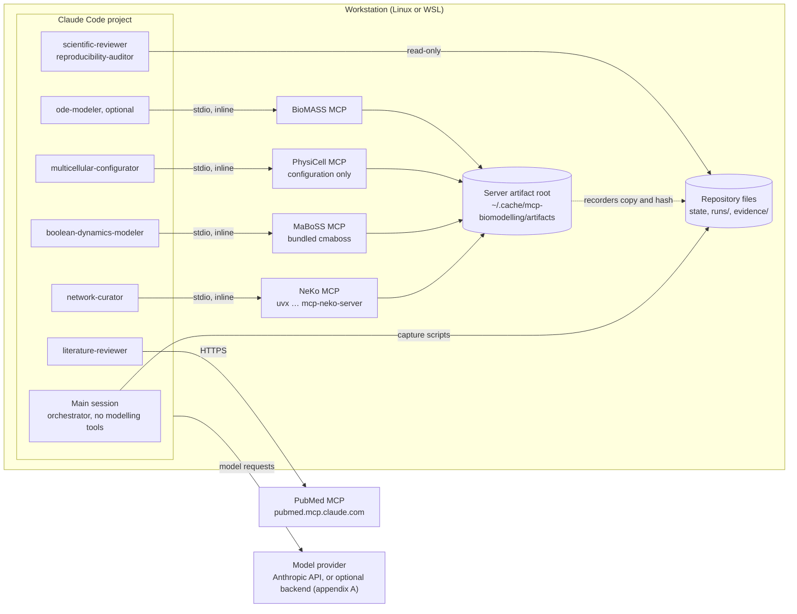

# Agentic biological-modelling system: architecture

**Document status:** describes release 1.0.1 (see
[`CHANGELOG.md`](../CHANGELOG.md), 2026-10-22), tested with
`mcp-biomodelling-servers` 2.5.1. For usage, see the [README](../README.md); for
day-to-day procedures, see [agentic operations](agentic-operations.md). Where this
document and the code disagree, the code is authoritative.

## 1. Purpose and scope

This repository is a workspace for building **one traceable mechanistic model per
repository**. The pipeline runs from a signalling network, through literature-backed
curation and stochastic Boolean dynamics, to a multicellular simulation
configuration. An optional branch builds mechanistic ODEs.

The design separates five concerns that are easy to blur when a single language-model
session does everything:

| Concern | Where it lives |
|---|---|
| Scientific orchestration and decisions | The main session (orchestrator) and the researcher |
| Model construction and simulation | Isolated specialists, each with exactly one modelling MCP server |
| Evidence | A literature specialist writing immutable, structured edge reports |
| Independent judgement | Two read-only reviewers |
| Durable state and provenance | Version-controlled files, captures, hashes and executable gates |

What the system deliberately does **not** do:

- **No PhysiCell simulation runs.** It produces PhysiCell/PhysiBoSS configuration for
  an existing executable.
- **No invented content.** It never infers units, never invents parameter values or
  citations, and never silently selects outputs, mutations, initial states or mappings.
- **Execution is not validation.** A successful run, a passing gate or a preserved
  artifact is not evidence of biological validity.
- **No ODE extras.** It has no ODE calibration, sensitivity analysis, or
  ODE-to-PhysiCell coupling.

## 2. Design principles

1. **Files, not chat, are the scientific record.** Decisions, assumptions, sessions,
   evidence and validation results are written to tracked files and immutable
   artifacts. Chat history and auto-memory are convenience only.
2. **Least privilege per role.**
   - Each modelling specialist sees exactly one modelling MCP server.
   - The orchestrator sees none.
   - The reviewers have read-only file tools.
3. **Humans own consequential choices.** Exploration and read-only inspection are
   autonomous. These require explicit researcher approval, recorded with the
   researcher's words:
   - topology, rule, readout or rate changes;
   - numerical values and units;
   - conclusive exports;
   - stage transitions.
4. **Approvals bind to exact revisions.** An approval names an exact NeKo state or
   MaBoSS `model_revision` and exact outputs. Any later edit supersedes it.
5. **Typed, verified handoffs between stages.** Stages exchange versioned manifests
   with hashes and lineage. They never exchange loose files or chat summaries.
6. **Fail closed.** A missing record, a hash mismatch, an unknown schema version or
   an incomplete check blocks; it never passes by default.

## 3. Actors and boundaries

| Actor | Modelling MCP access | Local tools | May write | Notes |
|---|---|---|---|---|
| Researcher | — | — | Everything | Approves consequential choices and stage transitions |
| Orchestrator (main session) | **None** | Full Claude Code tools | Shared scientific state | Sole shared-state writer. Delegates, validates handoffs, records decisions, runs gates and captures |
| `network-curator` | NeKo (`neko-agent`) | Read, Grep, Glob, ToolSearch, guarded Write | Its own `report.md` | Builds and curates networks. Topology mutations only on explicit instruction |
| `literature-reviewer` | PubMed (`pubmed`) | Read, Grep, Glob, ToolSearch, guarded Write | `evidence/reports/…` only | No model access. Reads SIF files by scoped Grep only |
| `boolean-dynamics-modeler` | MaBoSS (`maboss-agent`) | Read, Grep, Glob, ToolSearch, guarded Write | Its own `report.md` | Changes rules only in explicitly invoked refinement mode |
| `multicellular-configurator` | PhysiCell (`physicell-agent`) | Read, Grep, Glob, ToolSearch, guarded Write | Its own `report.md` | Configuration only; never runs PhysiCell |
| `ode-modeler` (optional) | BioMASS (`biomass-agent`) | Read, Grep, Glob, ToolSearch, guarded Write | Its own `report.md` | Cannot delegate, search literature or advance stages |
| `scientific-reviewer` | None | Read, Grep, Glob | Nothing | Reviews a bounded stage against its specification and evidence |
| `reproducibility-auditor` | None | Read, Grep, Glob | Nothing | Audits provenance, lineage and recorded verification |

Boundaries are enforced in four layers:

- **Agent frontmatter.** `tools` and `disallowedTools` set what each agent can call.
  Edit and Bash are disallowed for specialists. Session-deletion and cleanup tools
  (`delete_session`, `clean_generated_files`, and BioMASS `close_session`) are
  removed.
- **Hooks.** See section 4.
- **Executable gates.** See section 7.
- **The orchestrator policy.** [`CLAUDE.md`](../CLAUDE.md) for Claude and
  [`AGENTS.md`](../AGENTS.md) for Codex.

Specialists cannot spawn other agents, and they never coordinate directly. The
orchestrator routes all work, and files carry state between stages.

## 4. Isolation model

### 4.1 Inline, per-specialist transports

Each modelling server is defined **inline** in its specialist's frontmatter, under
`mcpServers:` as `neko-agent`, `maboss-agent`, `physicell-agent` and
`biomass-agent`. Claude Code starts an inline server when that specialist starts and
stops it when the invocation ends. The main session therefore never receives the
modelling tools.

The tracked default launch is the marketplace plugins' own command:

```text
uvx --from mcp-biomodelling-servers==2.5.1 mcp-<server>-server
```

`scripts/setup.py` can rewrite this block in two ways:

- **Plugin mode:** an absolute `uvx` path and a fixed `PATH`.
- **Managed or reused environment:** an absolute `<env>/bin/mcp-<server>-server`
  with `CONDA_PREFIX` and `PATH`.

See [automatic setup](automatic-setup.md).

### 4.2 Why the marketplace plugins are not enabled here

The same servers are published as `neko@marcorusc`, `maboss@marcorusc`,
`physicell@marcorusc` and `biomass@marcorusc`. Claude Code connects an enabled
plugin's MCP servers to the **main session**, as `mcp__plugin_<plugin>_<server>__*`,
and no supported setting scopes them to one subagent. Plugin-shipped agents also
ignore `mcpServers`, `hooks` and `permissionMode`.

This project therefore reuses the plugins' launch command inline, without enabling
the plugins. Use the plugins directly in projects that do not need orchestrator
isolation.

### 4.3 The isolation guard

`scripts/check_isolation.py` inspects configuration without starting servers. It
fails on any of the following:

- a global or project modelling registration (`.mcp.json`, `~/.claude.json`, Codex
  configuration);
- an enabled modelling plugin in project, local or user Claude settings;
- a project-wide allow rule for modelling tools, including `mcp__plugin_<server>_…`;
- an agent file missing its expected `<server>-agent` transport.

Setup runs it, and also checks that each operational skill's "Operational snapshot"
version matches the pinned backend. `--repository-only` checks the repository alone,
and the regression suites exercise the guard on fixtures. A static check cannot
prove what a running client has already been granted, so restart clients after any
change.

### 4.4 Hooks

| Hook | Script | Purpose |
|---|---|---|
| `PreToolUse` on `Agent`/`Task` (project) | `.claude/scripts/stage_gate_guard.py` | Before a MaBoSS or PhysiCell specialist is dispatched, requires a first-line `STAGE_GATE {...}` envelope and re-runs the gate against durable records |
| `SubagentStop` (project) | `.claude/scripts/record_specialist_invocation.py` | Persists each specialist invocation (task, tool calls and results, final output, usage) |
| `PreToolUse` on `Write` (each modelling specialist) | `.claude/scripts/specialist_report_guard.py` | Allows only `runs/<this specialist>/<session>/report.md`, for a session seen in this invocation's MCP calls |
| `PreToolUse` on `Read`/`Write` (literature reviewer) | `.claude/scripts/literature_file_guard.py` | Allows writes only under `evidence/reports/…`. Blocks full reads of `literature_queue.json` and SIF files |

ODE dispatch is deliberately not gated by the stage hook. It has its own source,
readiness and whole-model approval contract (section 5.5).

### 4.5 Workflow skills instead of resource manuals

Background Claude subagents keep MCP tools and `ToolSearch`, but not the host's
MCP-resource bridge. Each modelling specialist therefore preloads a versioned
operational skill (`neko-workflow`, `maboss-workflow`, `physicell-workflow`,
`biomass-workflow`), checked against the live tool schemas of the pinned release.
The main session delegates instead of loading these skills itself.

### 4.6 Codex

Codex uses [`AGENTS.md`](../AGENTS.md), the repository plugin skills under `skills/`,
and a **specialist dispatcher**. The dispatcher launches every specialist as a
separate, ephemeral `codex exec` process from a fixed profile. Each profile has
exactly one modelling server enabled; the parent profile has none.

`scripts/codex/check_environment.py` verifies those inventories without mutating
anything. Same-process files under `.codex/agents/` are not used, because they cannot
enforce per-child isolation. Details: [specialist dispatcher](specialist-dispatcher.md).

### 4.7 Runtime deployment



Source: [`runtime-deployment.mmd`](runtime-deployment.mmd).

## 5. Stage pipeline

```mermaid
flowchart TB
    S0[Specification<br/>MODEL_SPEC, ASSUMPTIONS,<br/>DATA_DICTIONARY, VALIDATION_PLAN] --> S1
    S1[NeKo topology<br/>network-curator] --> LIT[Literature review<br/>literature-reviewer]
    LIT --> DEC1{Researcher:<br/>topology changes?}
    DEC1 -- revise --> S1
    DEC1 -- accept --> V1[validate-stage<br/>reviewer + auditor]
    V1 --> A1{Researcher approval<br/>exact state + outputs}
    A1 --> X1[Typed NeKo→MaBoSS export<br/>captured and hashed]
    X1 -- gate.py check boolean-dynamics --> S2[MaBoSS dynamics<br/>boolean-dynamics-modeler]
    S2 --> DEC2{Researcher}
    DEC2 -- topology issue --> S1
    DEC2 -- refine named rules --> S2
    DEC2 -- accept --> V2[validate-stage]
    V2 --> A2{Approval<br/>exact model_revision + outputs}
    A2 --> X2[Typed MaBoSS→PhysiCell export]
    X2 -- gate.py check multicellular --> S3[PhysiCell configuration<br/>multicellular-configurator]
    S3 --> V3[validate-stage] --> CLOSE[Stage closure and checkpoint]
    X1 -. NeKo→BioMASS export<br/>gate.py check biomass_ode .-> ODE[Optional ODE branch<br/>ode-modeler]
```

Source: [`subagent-workflow.mmd`](subagent-workflow.mmd).

### 5.1 Specification

The orchestrator and researcher agree on the question, boundaries, observables,
inputs, units, alternatives and validation criteria. These are written to the state
files (section 7.1). `VALIDATION_CRITERIA.yaml` starts empty from its template and
cannot pass until it declares criteria.

### 5.2 Topology (NeKo) and literature

`network-curator` creates one NeKo session per hypothesis. Before construction or
repair it reports the effective policies (`path_policy`, `reuse_policy`, `max_len`,
`only_signed`, `consensus`).

NeKo's history records how the topology grew. Topology mutations happen only on
explicit instruction. A literature-supported interaction missing from the database
is added with `edit_interactions`, between existing nodes, as a `manual-literature`
edge carrying its rationale, evidence and PMIDs.

The orchestrator sends bounded edge slices to `literature-reviewer`. That
specialist writes one immutable report per edge, filed under the NeKo session the
edge came from. Gathering evidence is autonomous; acting on it (changing topology)
requires approval.

### 5.3 Boolean dynamics (MaBoSS)

The specialist imports the approved typed NeKo handoff. It selects outputs and
initial states only as instructed, and runs wild type and mutations under matched
settings.

Every ordinary and mutant run is durable and gets a run ID. The model state has a
`model_revision`.

Researcher-named summary readouts (`edit_maboss_readouts`) and per-node rates
(`update_maboss_parameters(rates=…)`) are applied only as instructed, against the
inspected revision. Rule changes happen only in explicitly invoked refinement mode
(section 7.6).

### 5.4 Multicellular configuration (PhysiCell)

The specialist builds the PhysiCell/PhysiBoSS configuration from the approved
MaBoSS handoff. Signal-node-behaviour mappings are explicit hypotheses. After each
change it reports the value actually stored, not the value it requested.

An exported configuration bundle (`export_configuration_bundle`) is packaging. It is
not a simulation run, and it is not an approval.

### 5.5 Optional ODE branch (BioMASS)

`ode-modeler` accepts three inputs:

- an approved NeKo→BioMASS graph;
- an explicitly authorized standalone Text2Model source;
- a bounded reaction request.

It uses ODE contract version 2 ([ODE contract](ode-contract.md)).

Saving a provisional candidate within an already authorized workflow is distinct
from scientific acceptance. Conclusive export needs an exact session/revision
decision. ODE claim reviews are filed under
`evidence/reports/<biomass_session_id>/ode/<claim_id>.md`.

Scientific ODE work remains gated on the live-isolation readiness check (Phase 5,
[ODE workflow](ode-workflow.md)).

## 6. Typed handoffs

| Handoff | Versions accepted by the gate | Added in the newest version |
|---|---|---|
| NeKo → MaBoSS | 1.0, 2.0, 2.1 | 2.0: verified source ancestry. 2.1: required `curation_file` NeKo history companion |
| MaBoSS → PhysiCell | 1.0, 2.0, 2.1 | 2.1: required `model_revision` and explicit `readouts` (may be `{}`) |
| NeKo → BioMASS | 1.0, 2.0 | 2.0: required `curation_file` |

Unknown versions fail. A 1.0 document cannot carry the newer fields. For MaBoSS 2.1,
readouts are the only nodes allowed beyond the NeKo parent. Each must match its BND
rule, and none may feed into core rules.

**Capture and relocation.** The orchestrator records each export into the project
with a recorder (section 8.2). The recorder copies and hashes the payloads, the
`curation_file` companion and, for NeKo Boolean exports, any `<bnet>.lineage.json`
source-lineage sidecar.

The 2.5.0 backend binds each companion to the model file's **original absolute
path**, so its own import tools reject the relocated copies. That gives each handoff
two roles:

- **The project capture** is the immutable record that gates and approvals bind to.
- **The original server manifest**, returned by the recorder as
  `backend_import_manifest`, is what the downstream specialist imports. Before
  dispatch, `scripts/capture/verify_import_manifest.py` confirms it is
  byte-identical to the captured original and that its payloads are unchanged.

Common envelope fields for specialist results are defined in
[handoff validation](handoff-validation.md).

## 7. Governance

### 7.1 Durable state files

| File | Contents |
|---|---|
| `MODEL_SPEC.md` | Mechanistic and mathematical specification |
| `DATA_DICTIONARY.md` | Identifiers, units, versions, provenance |
| `ASSUMPTIONS.md` | Accepted and proposed assumptions, kept distinct |
| `DECISIONS.md` | Decisions with rationale and structured governance records (reviews, approvals, conditional approvals) |
| `CURRENT_STATE.md` | Active stage, the append-only session registry, warnings, next action |
| `VALIDATION_PLAN.md` / `VALIDATION_CRITERIA.yaml` | Declared criterion IDs, executable criteria, validator-generated results |

The **session registry** has one row per specialist session, with these columns:

- Specialist, full Session ID, Stage;
- Status (`active` or `superseded`);
- Derived from (the upstream session);
- Handoff (`pending`, `approved` or `exported`);
- Artifacts.

Superseded rows are marked, never replaced. A downstream session may only derive
from an upstream row that is `exported`. Each server issues its own session ID;
there is no pipeline-wide run ID.

### 7.2 Checked state edits

The orchestrator never hand-edits structured records. `scripts/state.py` applies
JSON-file inputs atomically, with these operations:

- `decision`, `record`;
- `registry-add`, `registry-supersede`, `registry-handoff`;
- `validation-declare`, `validation`;
- `checkpoint`.

Missing or duplicate rows fail. Timestamps are timezone-aware ISO-8601.

### 7.3 Executable stage gates

`python3 scripts/gate.py check <downstream_stage> <upstream_session> --outputs …`
passes only if all of the following hold:

- the upstream registry row is `active`, at the expected stage, and `exported`;
- a researcher `stage_approval` names this session, this downstream stage and
  exactly these outputs, and the artifact it binds lies inside that session's
  `runs/` tree;
- the bound manifest verifies: schema version, owner and session, payload hashes and
  sizes, BNET/BND node order, curation companion, readout isolation, and the
  recursive parent chain;
- an independent `stage_review` (both reviewers) with outcome `approved` or
  `approved_with_limitations` covers the same artifact, and was recorded **before**
  the approval.

For `biomass_ode`, an ODE graph has no output selection, so the approval's outputs
must name every `node_id` of the exported graph.

`gate.py resolve <decision_id>` checks a conditional approval against immutable
evidence. It never mutates a model or grants new authority.

The orchestrator prefixes the delegated task with
`STAGE_GATE {"upstream_session_id": …, "outputs": […]}`, and the dispatch hook
re-checks it. Explicit standalone sources use a `standalone_decision_id` record
instead.

### 7.4 Approval binding

An approval is bound to the exact NeKo state or MaBoSS `model_revision`, the outputs
and the artifact hash it reviewed. Any later interaction, rule, readout or rate edit
produces a new revision. The older approval and export then no longer cover it: the
stage must be re-reviewed and re-approved. Approvals of one stage never authorize a
later stage.

### 7.5 Provenance tags

Every final Boolean rule and every manual edge is tagged in `DECISIONS.md`:

| Tag | Meaning |
|---|---|
| `database-default` | Imported database-derived rule or edge; not a literature claim |
| `literature-derived` | The specific rule or mechanism is supported by a dedicated cited review |
| `manual-literature` | An explicitly authorized manual edge added with `edit_interactions`, with its own candidate report, supporting PMIDs and approval |
| `fitted-for-dynamics` | Chosen to reproduce a named validation target. No independent literature claim for this Boolean form |
| `readout` | A researcher-named summary node added with `edit_maboss_readouts`, regulated only by core nodes, with a documented exclusivity proof |

### 7.6 Model refinement discipline

Adjusting rules to reproduce target dynamics is a legitimate method, but it must have
the discipline of a fitting procedure:

- an explicit objective taken from `VALIDATION_PLAN.md`;
- a bounded search, limited to the named nodes' **existing** incoming regulators;
- a record of every variant tried.

New nodes or edges are a topology question, which routes back to the curator and
literature review.

## 8. Provenance and capture

### 8.1 Repository layout

```text
repository/
├── CLAUDE.md  AGENTS.md            # orchestrator policy (Claude / Codex)
├── MODEL_SPEC.md  DATA_DICTIONARY.md  ASSUMPTIONS.md  DECISIONS.md
├── CURRENT_STATE.md  VALIDATION_PLAN.md  VALIDATION_CRITERIA.yaml
├── .claude/agents/  .claude/skills/  .claude/scripts/   # agents, skills, hooks
├── skills/  .codex/  .codex-plugin/  .agents/           # Codex plugin and profiles
├── scripts/   setup.py  check_isolation.py  state.py  gate.py
│   ├── capture/                    # recorders, index, invocation records
│   ├── validate/                   # read-only artifact analyses
│   └── codex/                      # dispatcher, launcher, handoff validator
├── setup/dependencies.toml         # pinned backend release
├── templates/  .model/config.json  # lifecycle templates and allowlist
├── inputs/                         # researcher source data
├── evidence/reports/<neko_session_id>/<source>__<target>.md
├── evidence/reports/<biomass_session_id>/ode/<claim_id>.md
└── runs/
    ├── index.json                  # script-maintained artifact and usage index
    ├── <specialist>/<session_id>/  # captures, report.md, invocation/<id>/
    └── orchestrator/<purpose>/     # summaries, reviews, manual inputs (CHANGES.md)
```

### 8.2 Recorders

Servers write their artifacts under the artifact root
(`$MCP_BIOMODELLING_ARTIFACT_ROOT/<Server>`, default
`~/.cache/mcp-biomodelling/artifacts/<Server>`). The orchestrator copies the exact,
returned artifacts into `runs/` with recorders in `scripts/capture/`:

| Recorder | Captures |
|---|---|
| `record_neko_boolean_handoff.py` | NeKo→MaBoSS manifest, BNET, curation companion, lineage sidecar |
| `record_maboss_physicell_handoff.py` | MaBoSS→PhysiCell manifest, BND/CFG, verified NeKo parent |
| `record_neko_ode_handoff.py` | NeKo→BioMASS manifest, network JSON, curation companion |
| `record_ode_artifacts.py` | An explicit BioMASS artifact inventory |
| `record_physicell_config.py` | PhysiCell configuration exports |

Every recorder follows the same rules:

- It selects its source explicitly (`--artifact-root` or a legacy `--server-root`),
  never from chat or the working directory.
- It verifies hashes before and after copying, publishes atomically, and never
  overwrites an existing capture.
- It writes `relocation.json` (or `capture.json`) and registers the capture in
  `runs/index.json`.

Details are in the [capture guide](../scripts/capture/README.md).

### 8.3 Invocation records and reports

The `SubagentStop` hook persists every specialist invocation. A session-bound
invocation goes to `runs/<specialist>/<session>/invocation/<id>/`. An attempt with no
session identity goes to `runs/orchestrator/unbound-invocations/<specialist>/<id>/`.

Unbound records cannot authorize scientific advancement. Each specialist writes one
immutable `report.md` through its Write guard. Orchestrator interpretation is kept
separately, under `runs/orchestrator/`.

Manual inputs, when unavoidable, need a `CHANGES.md` that records:

- the base path and SHA-256;
- the exact edits, in order;
- the evidence and supporting PMIDs;
- the authorization;
- the output path and SHA-256;
- a reproduction command or patch.

### 8.4 Evidence reports

An edge report ends with a structured footer, and it cites only `supporting_pmids`.
Reports are immutable. A re-review of a revised topology is written under the new
NeKo session, so each `DECISIONS.md` entry stays pinned to the exact report version it
cites. Candidate (proposed) edges and explicit revisions (`.r2.md`) have their own
locations.

## 9. Validation

- **Read-only validators.** `scripts/validate/` analyses captured artifacts only:
  - `evaluate.py` checks declared criteria (`ordered_peaks`, `canonical_cycles`,
    `boolean_structure`);
  - `boolean_structure.py` finds fixed points, bounded reachable attractors and
    readout exclusivity;
  - `validate_cycles.py` and `calibrate_cycle.py` handle cycle timing;
  - `plan_seeds.py` spaces simulation seeds.

  Missing inputs, malformed data or exhausted resource bounds give `incomplete`,
  never `passed`. Only validator output updates `VALIDATION_PLAN.md`, through
  `state.py`. See the [validator guide](../scripts/validate/README.md).
- **Independent review.** `/validate-stage` invokes `scientific-reviewer` and
  `reproducibility-auditor` sequentially, then records a `stage_review`. Their
  outcome is a prerequisite for the researcher approval the gate checks. Reviews never
  run in parallel with downstream work. In Codex, the equivalent workflow assigns the
  checks to the orchestrator followed by researcher approval; it is not independent
  review.
- **Software regression.** `scripts/run_tests.py` runs the Codex, Claude and setup
  suites. CI also runs them with the released backend installed, starts every server
  through the plugin launch, and runs a real-backend BioMASS smoke test
  (`tests/integration/biomass_smoke.py`). None of this is scientific validation.

## 10. Setup and deployment

`setup/dependencies.toml` pins the tested backend set: `mcp-biomodelling-servers`
2.5.1 and `nekomata` 1.10.2. `scripts/setup.py` offers three modes:

| Mode | What runs the servers | Trade-off |
|---|---|---|
| `--environment-mode plugin` | `uvx --from mcp-biomodelling-servers==2.5.1 …`. Needs only uv | Simplest. Only the server package is pinned; resolved dependency drift is reported as a warning |
| `managed` (default) | A setup-owned Conda or venv environment | Exact installed snapshot (`resolved-requirements.txt`) |
| `reuse` | An existing environment, verified but not modified | No installation |

No MaBoSS executable or system Graphviz is needed: the servers bundle cmaboss and
PyGraphviz. Setup runs in this order:

1. **Plan.** Check the skill snapshot versions and the selected clients.
2. **Verify before writing.** Check the environment or the resolved plugin launch,
   including the server version. With `--with-biomass`, also probe each server's
   capabilities. If this fails, nothing is written.
3. **Write.** Write the agent transports and Codex profiles, with backups.
4. **Verify after writing.** Probe each server's tool inventory through the exact
   transport, then run the client inventory checks and the isolation guard. The
   report fails if any of these fail.

Add `--with-biomass` for the ODE specialist. See [automatic setup](automatic-setup.md).

## 11. Model lifecycle

One repository holds one model. `/model-archive`, `/model-restart`, `/model-restore`
and `/model-list` manage alternative directions on local `model/*` branches with
annotated tags:

- `model/archive/*` for named archives;
- `model/recovery/*`, created automatically before a restart or restore.

[`.model/config.json`](../.model/config.json) is the allowlist:

- **Model state:** the state files, `VALIDATION_CRITERIA.yaml`, `evidence/`,
  `memory/`, `runs/` and `src/`.
- **Never reset:** `.claude/`, `.model/`, `CLAUDE.md`, `README.md`, `docs/`,
  `inputs/` and `templates/`.

Restores are path-scoped and never switch branches or roll back agent definitions.
MCP session IDs in an archive are provenance, not resumable state: specialists
rebuild runtime state from handoffs and artifacts. The mutating commands are
user-invoked only. `/checkpoint-model` records stage checkpoints on the current local
`model/*` branch, and never pushes.

## 12. Context and parallelism policy

- **Context.** The main context holds synthesis and decisions. Specialist contexts
  absorb large tool outputs. Servers return summaries and artifact paths rather than
  full tables or XML. Delegation prompts inline only the relevant slice of a large
  file, never "read the whole file". Checkpoint before `/compact` or `/clear`.
- **Literature slices.** Each reviewer invocation gets at most 13 coherent edges, as
  literal `[source, effect, target]` triples with known PMIDs. At most two reviewers
  run at a time (PubMed rate limits and backend stability). After an interruption,
  only missing reports are re-dispatched.
- **Search caps.** A reviewer makes one search per edge that already has references,
  and two bounded searches plus one related-article lookup for a PMID-less candidate.
- **Sessions.** Use one MCP session per independent hypothesis. Topology mutations
  stay sequential. MaBoSS and PhysiCell work run in parallel only on separate
  hypotheses or configurations.

## 13. Failure rules

- Never silently reuse a previous session or guess a session ID. Resolve it from the
  registry.
- Never ignore a tool error, an invalid handoff or a failed integrity check. A missing
  or failed required server returns `blocked`; never substitute another domain's server.
- Never let the literature specialist mutate a model.
- Never delete sessions or artifacts without explicit approval.
- Checkpoint partial results when an agent reaches its turn limit.
- Never equate successful execution with scientific validity.

## 14. Known limitations

See [`CHANGELOG.md`](../CHANGELOG.md) for the current list. At the time of writing:

- **BioMASS revisions from 2.5.0.** 2.5.0 sealed empty integrity inventories under
  the default `~/.cache` artifact root (fixed in 2.5.1). Such revisions fail
  verification and must be regenerated, not captured.
- **Headless runs.** Untrusted folders and headless runs (`claude -p`, SDK) skip
  inline subagent MCP servers. Verify specialists interactively.
- **Codex plugins.** Whether `codex mcp list` shows servers from an installed plugin
  is unverified. Do not add the modelling plugins to Codex for this project.
- **Plugin mode pinning.** Plugin mode pins only the server package.
- **ODE readiness.** Scientific ODE work awaits the Phase 5 live-isolation check.
- **Deferred items.** The Wave 2 items deferred by researcher decision
  (`docs/wave2-design-decisions.md`) remain deferred.

## Appendix A. Optional remote model backend (historical, not re-verified)

The design originally ran Claude Code against a remote Ollama server, recorded in
August 2026:

- model `qwen3.6:27b` with a 262,144-token context;
- an NVIDIA RTX 6000 Ada (about 48 GB VRAM);
- an SSH tunnel to `127.0.0.1:11435`;
- `ANTHROPIC_BASE_URL=http://127.0.0.1:11435`, `ENABLE_TOOL_SEARCH=true`,
  `OLLAMA_NUM_PARALLEL=1`, `OLLAMA_CONTEXT_LENGTH=262144`.

The observed figures at the time were about 34 GB VRAM for one full-context slot,
and a fresh Claude Code context of roughly 6% with on-demand tool loading. This
configuration has **not** been re-verified for release 1.0.0. Every agent uses
`model: inherit`, so any backend that runs the main session also runs the
specialists.

Two points from that design remain general:

- **One loaded model, many contexts.** A subagent is a separate logical context. On a
  local inference server it is another request to the same loaded weights, not
  another copy of them.
- **One inference slot is a sound default.** With `OLLAMA_NUM_PARALLEL=1`, several
  subagents may be alive while model requests queue. Server-side CPU work (NeKo
  queries, MaBoSS simulation, PubMed access) still overlaps. Ollama documents that
  parallel-slot memory scales with `OLLAMA_NUM_PARALLEL × OLLAMA_CONTEXT_LENGTH`.

## References

- Project: [README](../README.md), [documentation map](README.md),
  [agentic operations](agentic-operations.md), [automatic setup](automatic-setup.md),
  [handoff validation](handoff-validation.md), [ODE workflow](ode-workflow.md),
  [ODE contract](ode-contract.md), [specialist dispatcher](specialist-dispatcher.md),
  [capture guide](../scripts/capture/README.md), [validator guide](../scripts/validate/README.md).
- Servers: [mcp-biomodelling-servers](https://github.com/marcorusc/mcp-biomodelling-servers).
- Claude Code: [subagents](https://code.claude.com/docs/en/sub-agents),
  [plugins](https://code.claude.com/docs/en/plugins),
  [hooks](https://code.claude.com/docs/en/hooks),
  [skills](https://code.claude.com/docs/en/skills),
  [memory and CLAUDE.md](https://code.claude.com/docs/en/memory).
- Ollama concurrency: https://docs.ollama.com/faq
