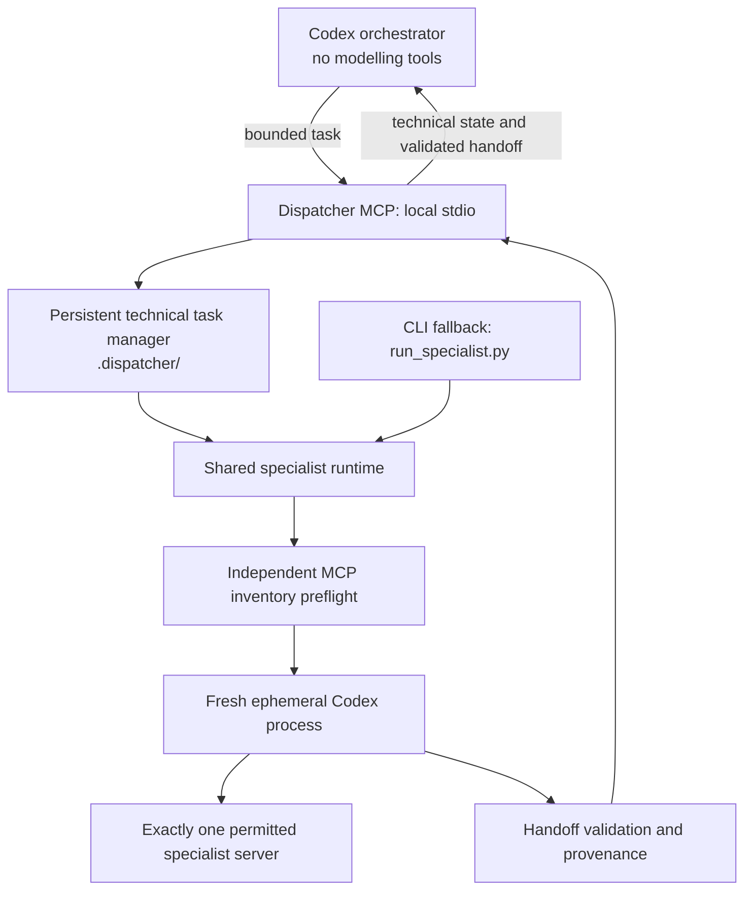

# Specialist dispatcher (Codex)

In Codex, specialist work runs through a **local stdio dispatcher**. It starts each
specialist as a separate, fresh `codex exec` process that has exactly one modelling
server. The Codex orchestrator never gets modelling tools. The dispatcher is the
preferred interface. `scripts/codex/run_specialist.py` is the supported command-line
fallback and debugging route through the same runtime.

Claude Code does not use the dispatcher. It isolates specialists with inline MCP
servers in `.claude/agents/` (see the [architecture](agentic-biomodelling-architecture.md)).
For startup, tool signatures and workstation configuration, see the
[dispatcher README](../scripts/codex/dispatcher/README.md).



## Isolation invariants

- **Fresh process per task.** Every invocation is a new `codex exec --ephemeral`
  process with a bounded task, a fixed specialist profile and a read-only sandbox.
  Orchestrator history and other specialists' transcripts are never forwarded, and
  nothing is resumed.
- **Same configuration for preflight and execution.** The inventory preflight and
  the execution use the same resolved executable, environment, working directory,
  profile transport and fixed MCP overrides. Unexpected enabled servers fail closed.
  Built-in app connectors (`features.apps=false`) and the dispatcher itself are
  disabled inside every specialist.
- **One server per role.** Each modelling role gets exactly its own server. The
  literature reviewer gets the approved literature backend (PubMed by default) and
  no modelling server. Exact tool approvals stay scoped to the permitted server;
  destructive tools stay disabled.
- **Validation, not exit codes.** A zero exit code alone is never success. Identity,
  lineage, typed handoff validation ([handoff validation](handoff-validation.md))
  and provenance recording must all pass. Technical execution state is reported
  separately from scientific status.
- **Root configuration.** `.codex/config.toml` keeps `neko`, `maboss`, `physicell`
  and `biomass` disabled for the orchestrator and enables only
  `specialist_dispatcher`.

Downstream Boolean dispatches (`boolean_dynamics_modeler`,
`multicellular_configurator`) must start with the checked `STAGE_GATE` envelope.
The runtime calls `scripts/gate.py` against the durable review and approval records
before launching a child. See [agentic operations](agentic-operations.md).

## Task lifecycle

The dispatcher exposes start tools for each specialist plus task inspection tools:
`get_specialist_task`, `get_specialist_events`, `list_specialist_tasks` and
`cancel_specialist_task`. Signatures are in the [dispatcher README](../scripts/codex/dispatcher/README.md).

1. **Start.** Task text is recorded durably before preflight. The start call returns
   a task ID before the child runs. A task ID identifies technical execution; it is
   not a scientific session ID.
2. **Follow.** Read progress with `get_specialist_events` using the last sequence
   cursor, and state with `get_specialist_task`. Heartbeats report activity, not
   success. Event queries return an operational projection only: no raw command
   arguments, search queries, tool results or reasoning.
3. **Finish.** Only a `succeeded` task carries a validated handoff. Inspect its
   scientific status (`completed`, `needs_approval`, `blocked`, `failed`) before
   considering any next stage. A scientific `blocked` result can still be a
   successful technical execution.

Concurrency: one active modelling worker globally and up to two literature
reviewers. Cancellation signals only managed children. Preflight has a 30-second
deadline, and a cancellation during preflight is honoured before any scientific
execution.

The file-backed `.dispatcher/` registry uses atomic writes, a single process lease
and strict path containment. Operational events live in
`.dispatcher/events/<task-id>.jsonl`. The sanitized raw Codex JSONL stays in the
invocation's `events.jsonl`. The registry is operational metadata and never replaces
scientific state.

## Recorded invocations

Each invocation writes beneath the applicable session directory:

```text
runs/<specialist>/<session>/specialist-invocations/<timestamp-and-uuid>/
├── task.txt
├── specialist-output.txt
├── handoff.json
├── events.jsonl
└── provenance.json
```

Provenance includes the role, profile, transport, timestamps, Codex version and
binary digest, effective modelling-server enablement, web-search flag, prompt hash
and exit code. It excludes executable paths, profile transports, environment values
and credentials. Literature invocations are recorded under the reviewed session:
NeKo edge reviews under `runs/network-curator/`, ODE claim reviews under
`runs/ode-modeler/`. A failed task may still leave useful partial artifacts. It
cannot authorize a downstream stage.

## Literature and ODE routes

`start_literature_reviewer` defaults to `review_kind="edge"`. Use `review_kind="ode"`
with the BioMASS `record_session_id` for bounded mechanism, kinetic-law and quantity
claims. Both modes share the literature profile, no modelling servers, and the limit
of two concurrent reviewers. PubMed is preferred. Web search
(`allow_web_search`) requires explicit researcher authorization. Without either
backend, the runtime records a scientific `blocked` result without starting a child.

`start_ode_modeler` uses the fixed `biomodel-ode-modeler` profile and permits only
BioMASS; the profile must exist (`scripts/setup.py --with-biomass`). Scientific ODE
work also requires the [ODE readiness check](ode-workflow.md#ode-readiness-check)
for the pinned backend.

## Repository plugin

The repository root is a local Codex plugin source. `.codex-plugin/plugin.json`
publishes the workflow skills under `skills/` and bundles no MCP servers, hooks,
executable paths or credentials. Setup registers and installs it as
`agentic-system-for-modelling@agentic-modelling-local`, from the marketplace file
`.agents/plugins/marketplace.json`. Reinstall after changing plugin skills. The
plugin contributes instructions only; the dispatcher transport stays in the project
`.codex/config.toml`, so execution stays bound to this repository.

Do not use the same-process agent templates under `.codex/agents/`: they cannot
enforce per-child isolation. Do not `codex plugin add` the marketplace modelling
plugins (`neko`, `maboss`, `physicell`, `biomass`) here; they would give the
orchestrator modelling tools.

## CLI fallback

Write the bounded task to the ignored project spool and pass the file as an argument:

```text
python scripts/codex/run_specialist.py network_curator --prompt-file .codex-tasks/network-inspection.txt
```

Use `--record-session-id` when a full upstream or existing session ID is known. Add
`--allow-web-search` only for `literature_reviewer` and only after authorization, and
`--review-kind ode --record-session-id <biomass-session>` for ODE claim reviews.
`scripts/codex/cleanup_tasks.py` previews verified leftover prompts and, with
`--apply`, removes them. It never removes unmatched prompts or scientific artifacts.

**Windows-to-WSL bridge.** Copy `.codex/launcher.example.json` to the ignored
`.codex/launcher.local.json`, then set the WSL distribution, absolute project path,
Python and Codex (0.153.0+) executables. Invoke the same entry point with
`--transport wsl`. The bridge builds a `wsl.exe` argument vector, never a shell
string, and the inner process records `transport=windows-wsl`. The bridge isolates
the child process only. A ChatGPT Windows parent app is unsupported unless an
external policy proves it has no modelling MCP tools.

## Troubleshooting and recovery

- **Dispatcher tools absent:** verify the project transport, the SDK interpreter and
  the native Codex home (see the [startup guide](../scripts/codex/dispatcher/README.md#workstation-startup)).
  Reload into a conversation on the same workspace and check the actual root
  inventory. A working CLI does not prove the desktop loaded the tools. Direct
  modelling tools in the root are a blocker.
- **Task still running:** follow `get_specialist_events` from the last cursor and
  check `get_specialist_task`. Cancel with `cancel_specialist_task`; never kill
  arbitrary processes.
- **Interrupted server:** preserve `.dispatcher/` and the invocation artifacts. A
  restart marks interrupted work failed and never resumes or retries it. Inspect
  partial artifacts before an explicitly requested replacement invocation.
- **Technical success, scientific failure:** read the typed result and its checks;
  technical delivery cannot authorize a stage transition. If only report persistence
  or local file verification remains, the parent can resolve it under the
  [artifact contract](handoff-validation.md) with a separate validated result.
  Failed modelling operations need diagnosis and a separately authorized invocation;
  never relabel them as successful.
- **A specialist reports a missing MCP server:** check its ignored user-local profile
  (templates in `.codex/profiles/`), then rerun
  `python scripts/codex/check_environment.py`. Never put a local executable path in
  tracked configuration.
- **Inventory stale after a configuration change:** fully reload the client and start
  a fresh Codex session before retesting.
- **WSL launch fails:** confirm every value in `.codex/launcher.local.json`, run the
  configured Python and Codex executables directly inside that distribution, and keep
  task paths repository-relative.
- **A recorded session ID no longer exists:** treat it as provenance and rebuild
  runtime state from the validated handoff and artifacts. Later adjustments import the
  exported artifact into a fresh session; see
  [NeKo curation continuity](neko-curation-continuity.md). Never silently reuse
  another session.
- **Task prompts remain after checkpointing:** run `cleanup_tasks.py` without
  `--apply` and inspect the `unmatched` reasons. A missing invocation record is a
  provenance problem, not permission to delete the prompt.
- **Marketplace plugins:** `check_environment.py` blocks enabled root servers named
  `neko`, `maboss`, `physicell` or `biomass` in `codex mcp list`. Whether Codex lists
  plugin-provided servers there is not verified, so do not install those plugins here.
- **Rollback:** set `mcp_servers.specialist_dispatcher.enabled=false` in the project
  configuration, keep the modelling servers disabled, and use the CLI. Keep profiles,
  sessions, histories and task records.

Enforcement differences from Claude Code (hooks, report writing) are listed in
[Codex enforcement mapping](codex-enforcement.md).
